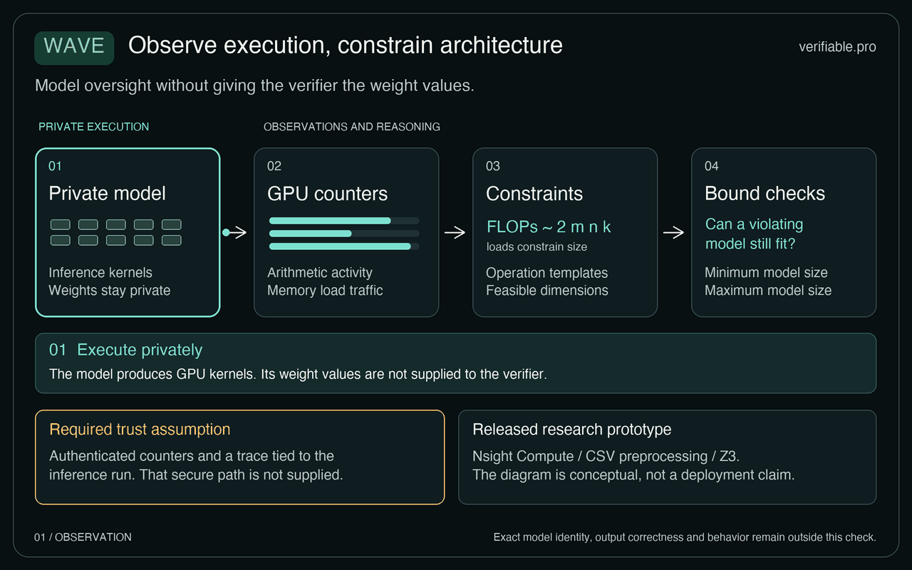
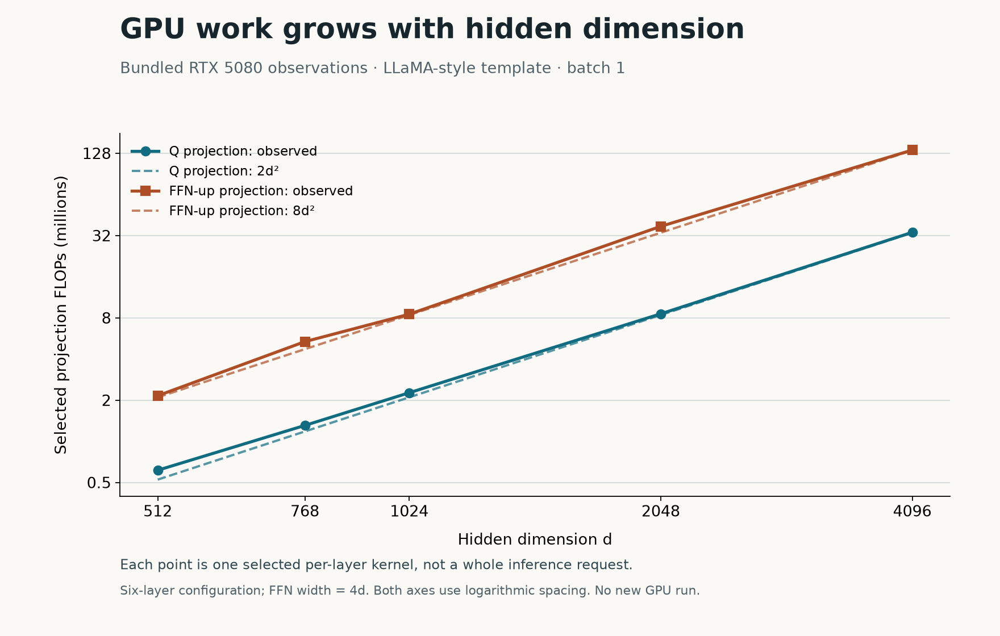
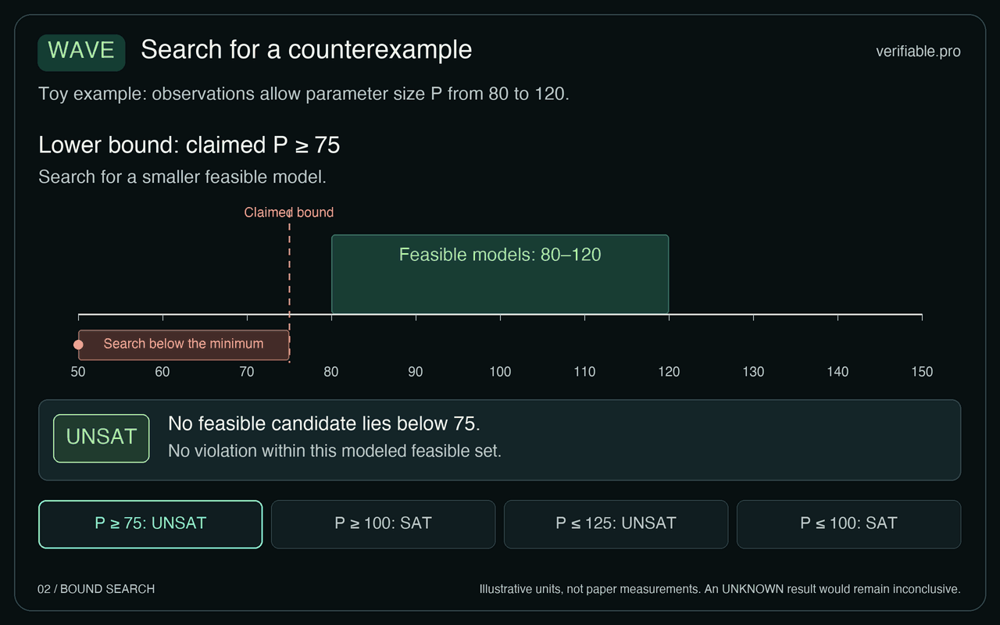

<div align="center">

# Wave

### Model oversight from GPU execution traces

**Check model-size promises against observed GPU work.**

[Paper](https://doi.org/10.1145/3779212.3790247) · [Author PDF](https://terryxu.site/assets/pdf/wave-asplos26.pdf) · [Reproduction guide](docs/reproduction.md) · [MIT license](LICENSE)

ASPLOS 2026 · SEPT Lab, University of Southern California · Carnegie Mellon University

[](https://verifiable.pro/)

</div>

Wave uses GPU performance monitoring counters (PMCs) to examine the structure and size of dense language models during inference. Its analyzer recovers repeated layer patterns from hardware measurements. Its constraint solver then asks whether those measurements could describe a model that violates the provider's size promise, without reading model weights or user prompts.

This repository is the research artifact for **Wave: Leveraging Architecture Observation for Privacy-Preserving Model Oversight**. It includes recorded traces, an analyzer, an SMT-based verifier, and scripts for collecting new measurements. The prototype studies structural evidence; it does not certify exact weights or the correctness of an answer. A trustworthy, authenticated trace tied to the request remains a deployment requirement.



*From execution to a structural claim. This is an explanatory schematic, not a live profiling recording. [Static image](docs/figures/wave-observation.png) · [Figure sources and provenance](docs/figures/README.md)*

## Get a first result without a GPU

The repository includes measurements from RTX 4090, RTX 5080, and H100 GPUs. You can inspect a recorded experiment before installing the inference stack. Clone the repository, then run the analysis from its root using Python 3:

```bash
git clone https://github.com/sept-usc/Wave.git
cd Wave
python3 scripts/analyze_overhead.py data/overhead/h100/all/overhead_summary.txt
```

The script uses only the Python standard library. It reads the six bundled H100 measurements and prints an average profiling overhead of **1340%**, with a range of **1196–1585%**. This reanalyzes saved results; it does not run inference or validate a new service. The high cost comes from the prototype's profiling path, so low-overhead runtime monitoring remains future work.

For the solver and plotting workflows, install [uv](https://docs.astral.sh/uv/) and use the project's Python 3.12 environment:

```bash
uv sync
uv run scripts/verify_lower_bound.py --model-size tight --data-folder data/lower_bound/h100/processed/
```

This second command checks existing CSV traces on the CPU. The project's dependencies include PyTorch, which is also imported by the verifier package; a CUDA GPU is needed only when collecting new traces. See the [reproduction guide](docs/reproduction.md) for software versions, output interpretation, and the other experiments.

## What the counters tell us

A dense hidden-to-hidden projection with hidden dimension `d` and batch size `b` requires approximately `2 × b × d²` floating-point operations during one decoding step. Increasing `d` changes the work within each projection. Adding layers repeats the pattern. Memory traffic supplies additional constraints on the possible matrix dimensions.



*Recorded RTX 5080 measurements from the bundled LLaMA-style traces, compared with the matrix-operation model. The plot shows selected per-layer projections on logarithmic axes; it is not a new GPU experiment. [Data and renderer](docs/figures/README.md)*

Wave uses that relationship in two stages:

1. **Infer a structure from the trace.** The analyzer combines FLOPs, shared-memory activity, and load/store bytes to detect repeated token and layer patterns. It assigns roles such as attention projections and feed-forward operations.
2. **Search for a violation of the promise.** The verifier asks whether matrix dimensions and allowed kernel splits can explain the measurements while placing the model below a claimed minimum or above a claimed maximum.



*A satisfying solver result is a possible violation of the promise under the model. “No solution” is conditional on the encoded operations and measurement tolerances. The animation uses illustrative values. [Static image](docs/figures/wave-bounds.png) · [Figure sources](docs/figures/README.md)*

The evaluation scripts use the following thresholds. “Actual size” here is the experiment's **per-layer parameter expression**, not a full checkpoint size including embeddings.

| Experiment | Mode | Promise | Expected solver result |
|---|---|---|---|
| Lower bound | `tight` | Minimum = 0.75 × actual size | No violating solution |
| Lower bound | `loose` | Minimum = 1.25 × actual size | A violating solution |
| Upper bound | `tight` | Maximum = 0.9 × actual size | A violating solution |
| Upper bound | `loose` | Maximum = 1.1 × actual size | No violating solution |

**Read the CLI output carefully:** “Verification succeeded” or “Success” means a solution was found. In these experiments, that solution is a candidate that violates the size promise. Use the reported **results matching expectations** to interpret an experiment, rather than treating “Success” as the provider passing verification. See [solver-result semantics](docs/reproduction.md#interpret-the-solver-results) for the current API's limitations.

## Reproduce the paper's experiments

| Question | Included data | Instructions |
|---|---|---|
| How do FLOPs change with hidden dimension and layer count? | LLaMA-style traces on RTX 5080 | [Motivating example](docs/reproduction.md#flops-and-model-scale) |
| Do measured projection loads track the matrix model? | GPT-2, LLaMA, and Qwen traces across three GPUs | [Load bytes](docs/reproduction.md#qkv-load-bytes) |
| Could the execution use a model below a promised minimum? | Lower-bound processed CSVs | [Minimum-size checks](docs/reproduction.md#model-lower-bound) |
| Can split kernels hide a model above a maximum? | 14 upper-bound cases | [Maximum-size checks](docs/reproduction.md#model-upper-bound) |
| What does collecting the counters cost? | Baseline and profiling logs | [Overhead](docs/reproduction.md#profiling-overhead) |

The original evaluation uses customized GPT-2, LLaMA, and Qwen architecture templates. The provided datasets support replay and inspection of those experiments. They do not establish performance on every pretrained checkpoint or production serving configuration.

## Scope and trust assumptions

Wave currently studies dense decoder inference on a single GPU, primarily during decoding with static batching. Its analytical model and tolerances must match the workload. Quantization, advanced kernel fusion, distributed inference, continuous batching, and mixture-of-experts models require additional modeling and evaluation.

The design assumes that the verifier receives authentic counters bound to the inference being checked. This artifact collects traces with Nsight Compute; it does not implement an end-to-end attested reporting service. Counter patterns can reveal architecture information even though the monitor does not directly inspect prompt contents or weight values. Exact weight identity, fine-tuned variants, output correctness, and model quality are outside its claim.

Profiling is also expensive in the released setup. Reanalysis of the bundled full-metric logs gives average overheads of 4688.50% on RTX 4090, 3006.67% on RTX 5080, and 1340.00% on H100. These are overhead percentages above the unprofiled baseline. See [the source packet](docs/editorial-evidence/source-packet.md) for provenance and the checks performed for this documentation update.

## Repository map

| Path | Purpose |
|---|---|
| [`src/gpu_pmc_analyzer/`](src/gpu_pmc_analyzer/) | Preprocess counters and recover recurring execution patterns |
| [`src/gpu_pmc_verifier/`](src/gpu_pmc_verifier/) | Encode matrix constraints and split-operation checks |
| [`eval/`](eval/) | Inference and collection entry points |
| [`scripts/`](scripts/) | Experiment collection, replay, and plotting |
| [`data/`](data/) | Recorded traces and overhead measurements |
| [`figs/`](figs/) | Original experiment plots |
| [`docs/figures/`](docs/figures/) | Explanatory animations, static alternatives, and generation sources |

## Further reading

The companion [verifiable.pro](https://verifiable.pro/) explainer is available as an [English draft](docs/verifiable-pro/en.md) and a [Chinese draft](docs/verifiable-pro/zh.md), with animations and recorded-data analysis. **Article status: awaiting editorial approval.** SEPT Lab maintains both this project and verifiable.pro; the article explains the work and does not constitute independent validation.

## Cite Wave

```bibtex
@inproceedings{xu2026wave,
  author    = {Haoxuan Xu and Chen Gong and Beijie Liu and Haizhong Zheng and Beidi Chen and Mengyuan Li},
  title     = {Wave: Leveraging Architecture Observation for Privacy-Preserving Model Oversight},
  booktitle = {Proceedings of the 31st ACM International Conference on Architectural Support for Programming Languages and Operating Systems, Volume 2},
  year      = {2026},
  pages     = {2212--2231},
  doi       = {10.1145/3779212.3790247}
}
```

Haoxuan Xu, Chen Gong, and Beijie Liu contributed equally. Mengyuan Li is the corresponding author. The code and technical documentation use the [MIT license](LICENSE). Original presentation figures are available under MIT or CC BY 4.0; the companion article drafts use CC BY 4.0. See the [figure provenance](docs/figures/README.md). The linked paper carries its own publication license.
