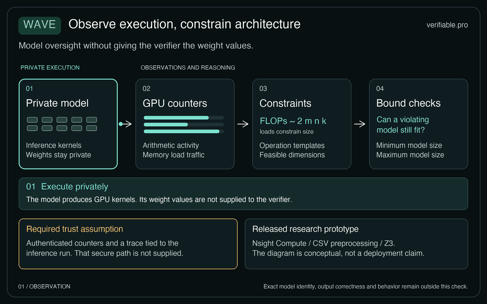
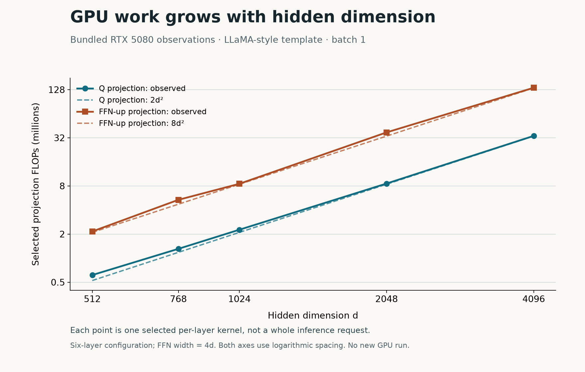
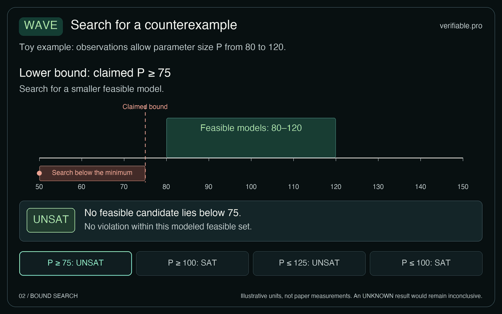

Wave checks lower or upper bounds on model parameter counts using selected graphics processing unit (GPU) performance monitoring counter (PMC) observations, under explicit assumptions about computation and measurement. Consider a service promising a model with at least a specified parameter count. A smaller substitute may still return plausible answers, so outputs alone can leave that promise unresolved. Wave examines evidence of the GPU work behind those answers. Its size checks do not establish exact model identity, weight values, output correctness, or safety.[^1]

This is a specific evidence claim within the broader question of [what makes an AI system verifiable](https://verifiable.pro/articles/what-makes-an-ai-system-verifiable/). The useful question is whether the observed computation leaves room for a model outside the promised size range. Answering it need not require recovering one unique architecture.

## From GPU observations to a structural sketch

*From private execution to counter observations, operation constraints and a model-size question. The authenticated measurement path is a deployment requirement; this schematic does not depict a delivered remote-verification service. Select play to follow the four stages.  ·  · . Original explanatory diagram. [Still image](../figures/wave-observation.png).*

PMCs are hardware measurements of execution activity, including arithmetic instructions and memory traffic. Wave’s proof of concept collects them with NVIDIA Nsight Compute, then analyzes traces and runs a constraint solver on the CPU. The paper assumes a trustworthy observation path. Device-signed counter evidence, remote verification of that evidence, and integration with CPU or GPU trusted execution environments (TEEs) remain proposed deployment mechanisms. The release does not deliver an authenticated channel binding counters to a particular user query.[^1][^2]

That gap matters immediately: reasoning correctly about a supplied trace cannot establish that an untrusted provider supplied the right trace. A future evidence channel would need to authenticate the observations and connect them to the relevant execution. Our [remote attestation explainer](https://verifiable.pro/articles/remote-attestation-for-ai-workloads-explained/) explains the role of that connection. Wave’s current analyzer and solver address the interpretation of observations once their trustworthiness is assumed.[^1]

The computational basis is general matrix multiplication (GEMM), the family of matrix operations underlying transformer projections. For `(B,M,K) @ (K,N)`, Wave models a core arithmetic lower bound of `2*B*M*K*N` floating-point operations. At element width `w` bytes, modeled minimum loads are `w*(B*M*K + K*N)` and stores are `w*B*M*N`. These relationships connect measured work to possible matrix dimensions; implementation effects require tolerances.[^1][^2]

For one decoding token per batch item, a dense hidden-to-hidden projection requires approximately `2*b*d²` operations, where `b` is batch size and `d` is hidden dimension. Doubling `d` quadruples that projection’s modeled arithmetic. Repeating fixed-size layers increases work linearly. This makes counters informative about size, while also explaining why total work alone cannot uniquely identify an architecture: different dimensions and repetition counts can produce overlapping observations.[^1]

*Replotted from the artifact’s RTX 5080 CSVs: selected per-layer Q and FFN-up kernels, batch 1, six-layer LLaMA-style configurations, FFN width 4d. Dashed lines show 2d² and 8d²; both axes use logarithmic spacing. These are saved observations, not new GPU measurements or whole-request totals.*

Wave therefore examines patterns across kernels. The artifact constructs features from floating-point operations, the shared-memory instruction ratio, and aggregate load/store bytes. Repetition helps locate decoding tokens and transformer layers. Within a layer, the analyzer aligns candidate kernels with expected projection roles. Its GPT-2 default uses QKV, output projection, and two feed-forward projections with FLOP ratios of 3:1:4:4. LLaMA/Qwen defaults accommodate separate Q/K/V and three feed-forward projections. These templates matter because framework changes can change the patterns.[^1][^2]

## Checking a range without identifying one architecture

*A toy example: the modeled observations allow sizes from 80 to 120, in illustrative units. The animation checks minima of 75 and 100, then maxima of 125 and 100. SAT supplies a violating candidate; UNSAT excludes one only within this modeled set. These are illustrative values, not measured parameter counts.  ·  · . Original explanatory diagram. [Still image](../figures/wave-bounds.png).*

The structural sketch provides estimates, but estimates from selected kernels can disagree or miss allowed manipulations. Wave’s second stage asks a global consistency question using satisfiability modulo theories (SMT), a method for solving logical constraints with arithmetic relationships. It searches for a canonical model explanation that fits the observations within tolerance and violates the promise.[^1]

For a minimum-size promise, the search requires a candidate size below that minimum. For a maximum-size promise, it requires a candidate above the maximum. A satisfiable result, SAT, supplies a possible counterexample. It means the evidence admits a violating explanation, without establishing that this explanation uniquely describes the actual execution. An unsatisfiable result, UNSAT, means no violating explanation exists inside the encoded search space. Its force depends on the template, permitted transformations, measurement bounds, and trustworthy observations. Neither result is a correctness certificate for inference.[^1]

The size expression also has a defined boundary. The artifact approximates transformer-block parameters as `L*(4*d*d + g*d*d_ffn)`, where `L` is layer count and `g` is two or three feed-forward projections. Embeddings and low-order terms are excluded. Readers should interpret a threshold against this modeled quantity, rather than treating it as an exact full-checkpoint count.[^1][^2]

Kernel splitting illustrates the value of structural reasoning. Two smaller matrix kernels can represent parts of one original operation. Splitting does not itself reduce the reconstructed model size. The formal attack scope, however, is restricted to modeled splits: each canonical operation undergoes at most one attack, and each observed kernel comes from one canonical operation. It does not establish coverage of arbitrary adversarial programs, large-scale substitutions, or general fusion and reordering.[^1]

:::analysis
A size-range check can be useful even when several architectures fit the same observations. Its value comes from excluding violating explanations within a stated model. The deployment question remains whether that model covers the execution and whether the evidence belongs to the request being checked. These are separate obligations in [evaluating a verifiable inference claim](https://verifiable.pro/articles/evaluating-a-verifiable-inference-claim/).
:::

## Reading the artifact’s thresholds and results

The release’s command labels need careful interpretation. Its scripts use the following thresholds relative to the actual per-layer size in each test. The upper-bound implementation uses 0.9 and 1.1; the original README’s upper-bound ratios are incorrect.[^2]

| Check | Script setting | Promised threshold | Counterexample search |
| --- | --- | --- | --- |
| Lower bound | tight | 0.75× actual | Size below minimum |
| Lower bound | loose | 1.25× actual | Size below minimum |
| Upper bound | tight | 0.9× actual | Size above maximum |
| Upper bound | loose | 1.1× actual | Size above maximum |

Consequently, the CLI message “Verification succeeded” means a solution was found: a possible violation. It does not mean the provider passed. The current `verify()` implementation also returns `None` for non-SAT outcomes without preserving their distinction, so its result handling should not be described as a production verifier that safely rejects every unresolved case.[^2]

The authors evaluated customized GPT-2, LLaMA, and Qwen architecture templates, using FP32 by default, on RTX 4090, RTX 5080, and H100 GPUs. These were architecture experiments rather than pretrained-checkpoint identification. The abstract’s 6.8% figure concerns recovered architectural parameters; Section 6.1 reports about 11% average model-size error. Lower-bound tests include missed violations. The committed processed lower-bound data contains 38, 33, and 44 cases for the three GPUs respectively, so availability differs by device.[^1][^2]

The upper-bound experiment is narrower: 14 cases using a single-layer GPT-2-like model on RTX 4090, with hidden dimension 1024 and feed-forward dimension 4096. The authors report no false positives or false negatives there and completion within one minute. Those results support that tested split configuration space; they do not establish universal detection.[^1]

## Profiling cost and practical inspection

Full Nsight profiling is expensive. Reanalysis of the bundled overhead logs, without fresh GPU execution, gives average additional overhead of 4688.50% on RTX 4090, 3006.67% on RTX 5080, and 1340.00% on H100 for the recorded configurations collecting Wave’s metrics. The definition is `(profiled/baseline - 1)*100`. Thus 1340% overhead means about 14.4× baseline runtime. These are profiling measurements, separate from the paper’s proposed low-cost hardware counter logging, which requires future interface support.[^1][^2]

Readers without a GPU can inspect bundled CSV traces and replay analysis through the [Wave repository](https://github.com/sept-usc/Wave). Overhead-log analysis uses only Python’s standard library. Verifier replay needs additional dependencies: its normal import path also imports attack code requiring PyTorch. Optional fresh collection follows the repository’s NVIDIA GPU, CUDA, PyTorch, and Nsight workflow. The setup script can install tools and change Linux profiling settings, so it is unnecessary for simply reading saved results.[^2]

## Scope and information exposure

The evaluated setting is dense decoder transformers on one GPU, primarily decoding with key-value (KV) caching and static batching. Quantization, vLLM/SGLang-style optimizations, distributed inference, continuous batching, and mixture-of-experts models need separate support or lie outside the evaluated scope. Counter precision matters: the paper describes excessive loads and reduced stores that break modeled bounds and cause missed violations. Tolerance selection is part of the claim’s assumptions.[^1]

Wave avoids directly reading weights or prompts, while deliberately revealing structural information such as dimensions, layer counts, and computational scale. The paper proposes protected verification to limit raw-trace exposure; that is future integration. Aggregate observations do not provide a general privacy guarantee, and models sharing a structure, including fine-tuned variants, remain indistinguishable through these size checks.[^1]

:::checked
We read the paper and artifact on 6 November 2026.

The source review covered the paper and artifact at commit `29773cd`, including preprocessing, verifier, collector, and setup entry points. Saved-data inspection and reanalysis of the three bundled overhead logs used existing measurements. We performed no independent GPU collection, inference reproduction, or remote deployment test, and this review does not certify Wave.[^1][^2]
:::
