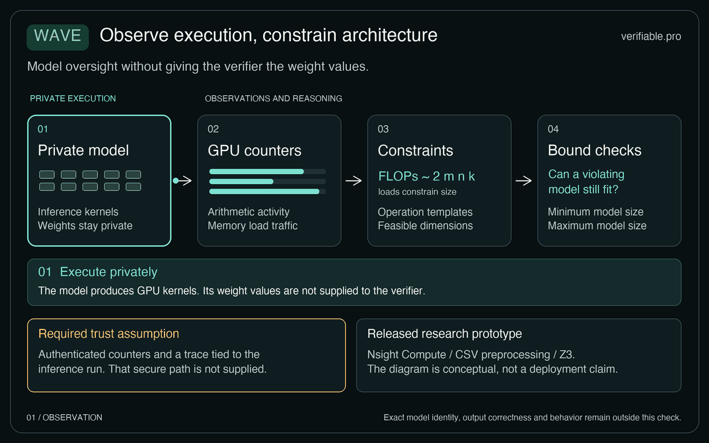
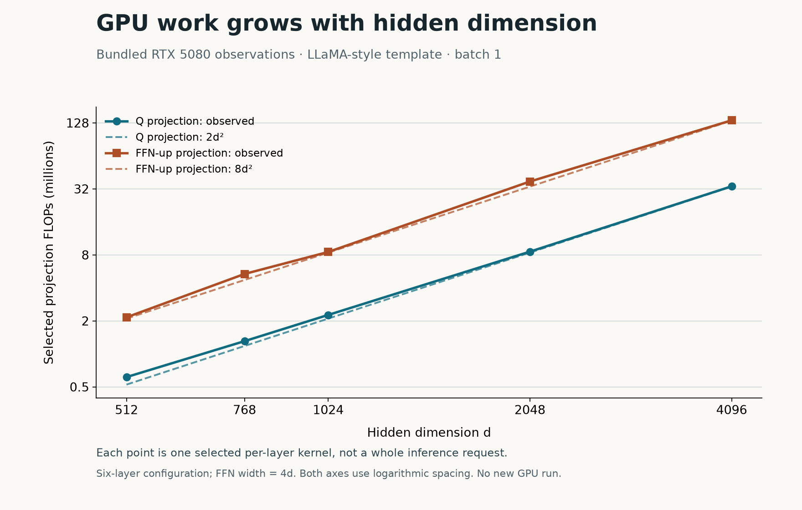
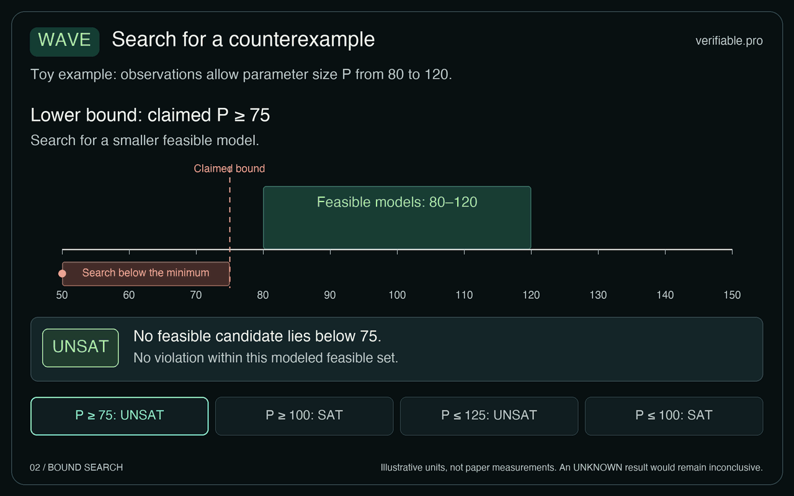

Wave 利用选定的 GPU 性能监控计数器（performance monitoring counters，PMCs）观测，在明确的计算与测量假设下，检查模型参数量的下界或上界。设想一家服务承诺使用参数量至少达到某个门槛的模型。规模更小的替代模型也可能给出看似合理的回答，仅凭输出，用户难以核实这项承诺。Wave 检查回答背后的 GPU 计算证据。这类规模检查不能确认模型的精确身份、权重数值、输出正确性或安全性。[^1]

这是[什么让 AI 系统可验证](https://verifiable.pro/zh/articles/what-makes-an-ai-system-verifiable/)这一更大问题中的一项具体证据主张。关键在于，观测到的计算是否仍允许模型规模落在承诺范围之外。回答这个问题，未必需要还原出唯一的架构。

## 从 GPU 观测到结构草图

*从私有执行到计数器观测，再到运算约束和模型规模问题。经过认证的测量路径是部署前提；本示意图不表示仓库已交付远程验证服务。点击播放查看四个阶段。  ·  · . 原创解释性示意图. [静态图](../figures/wave-observation.png).*

PMCs 是对硬件执行活动的测量，包括算术指令和内存流量。Wave 的概念验证原型通过 NVIDIA Nsight Compute 采集数据，随后在 CPU 上分析轨迹并运行约束求解器。论文假设观测路径可信。由设备签名的计数器证据、对这类证据的远程验证，以及与 CPU 或 GPU 可信执行环境（TEE）的集成，仍是拟议中的部署机制。公开实现没有交付将计数器与某次用户查询绑定的认证通道。[^1][^2]

这个缺口直接影响结论：即使对一份轨迹的推理完全正确，也无法据此确认不可信提供方提交的就是相关执行的真实轨迹。未来的证据通道需要认证观测，并将其关联到对应执行。本站的[远程证明解析](https://verifiable.pro/zh/articles/remote-attestation-for-ai-workloads-explained/)介绍了这种关联的作用。Wave 当前的分析器与求解器，处理的是在观测可信这一前提下如何解释数据。[^1]

其计算依据是通用矩阵乘法（general matrix multiplication，GEMM），即支撑 Transformer 投影计算的一类矩阵运算。对于 `(B,M,K) @ (K,N)`，Wave 将核心浮点运算量下界建模为 `2*B*M*K*N`。若每个元素占 `w` 字节，模型中的最低读取量为 `w*(B*M*K + K*N)`，最低写入量为 `w*B*M*N`。这些关系将测得的工作量与可能的矩阵维度联系起来；实现带来的差异则需要容差。[^1][^2]

在批次内每个样本解码一个词元时，稠密的隐藏维度到隐藏维度投影约需 `2*b*d²` 次运算，其中 `b` 为批大小，`d` 为隐藏维度。将 `d` 翻倍，该投影的理论运算量就变为四倍；重复相同尺寸的层，工作量则线性增加。这解释了计数器为何能提供规模信息，也说明总工作量为何不足以唯一确定架构：不同维度与重复次数可能对应重叠的观测。[^1]

*根据工件的 RTX 5080 CSV 数据重绘：选定的每层 Q 和前馈上投影内核，批大小为 1，采用六层 LLaMA 风格配置，前馈维度为 4d。虚线表示 2d² 和 8d²，两轴均采用对数刻度。这是已有观测，不是新的 GPU 测量，也不是整个请求的总运算量。.*

因此，Wave 会分析多个内核之间的模式。工件从浮点运算量、共享内存指令占比，以及读写总字节数构造特征。重复模式帮助定位解码词元和 Transformer 层。在每层内部，分析器将候选内核与预期的投影角色对齐。其 GPT-2 默认模式包含 QKV、输出投影和两个前馈投影，FLOP 比例为 3:1:4:4。LLaMA/Qwen 默认模式支持独立的 Q/K/V 和三个前馈投影。这些模板是分析依据，而框架变化可能改变对应模式。[^1][^2]

## 无需唯一识别架构，也能检查规模范围

*假设示例：建模后的观测允许规模位于 80 到 120 之间，数值仅用于说明。动图依次检查下界 75、下界 100、上界 125 和上界 100。SAT 给出违反声明的候选；UNSAT 只在当前建模集合内排除反例。图中数值并非实测参数量。  ·  · . 原创解释性示意图. [静态图](../figures/wave-bounds.png).*

结构草图可以给出估计，但从部分内核得到的估计可能互相冲突，也可能遗漏允许的变换。Wave 的第二阶段使用可满足性模理论（satisfiability modulo theories，SMT）提出全局一致性问题。这种方法求解包含算术关系的逻辑约束，寻找既能在容差内解释观测、又违反规模承诺的规范模型解释。[^1]

对于最低规模承诺，搜索要求候选规模低于下限；对于最高规模承诺，则要求候选规模高于上限。可满足结果 SAT 会给出一个可能的反例。它表示证据允许一种违反承诺的解释，并不能确认这就是实际执行的唯一解释。不可满足结果 UNSAT 表示，在已编码的搜索空间中不存在违反承诺的解释。其效力取决于模板、允许的变换、测量边界以及观测的可信性。两种结果都不是推理正确性证书。[^1]

规模表达式本身也有明确边界。工件用 `L*(4*d*d + g*d*d_ffn)` 近似 Transformer 块的参数量，其中 `L` 为层数，`g` 为两个或三个前馈投影。它不包括嵌入参数及低阶项。因此，读者应将门槛理解为针对这个建模量的约束，不能将其视为完整检查点的精确参数量。[^1][^2]

内核拆分说明了结构推理的作用。两个较小的矩阵内核，可能分别执行同一个原始运算的一部分。拆分本身不会使重建出的模型规模缩小。不过，形式化攻击范围仅限于已建模的拆分：每个规范运算最多经历一次攻击，每个观测内核都来自一个规范运算。论文没有建立对任意对抗程序、大规模替换，或一般性融合与重排的覆盖。[^1]

:::analysis
即使多种架构都能解释同一组观测，规模范围检查仍可能有用。其价值在于，在明确模型内排除违反承诺的解释。部署时仍需确认模型覆盖了实际执行，并确认这份证据属于待检查的请求。在[评估可验证推理主张](https://verifiable.pro/zh/articles/evaluating-a-verifiable-inference-claim/)时，这些是需要分别满足的条件。
:::

## 理解工件的门槛与实验结果

公开版本的命令标签需要谨慎解读。各脚本使用的门槛如下，均相对于对应测试的真实每层参数量。上界实现使用 0.9 和 1.1；原始 README 中的上界比例有误。[^2]

| 检查类型 | 脚本设置 | 承诺门槛 | 反例搜索 |
| --- | --- | --- | --- |
| 下界 | tight | 真实值的 0.75 倍 | 规模低于下限 |
| 下界 | loose | 真实值的 1.25 倍 | 规模低于下限 |
| 上界 | tight | 真实值的 0.9 倍 | 规模高于上限 |
| 上界 | loose | 真实值的 1.1 倍 | 规模高于上限 |

因此，命令行提示“Verification succeeded”表示找到了一个解，也就是可能的违规解释，不能理解为提供方通过检查。当前 `verify()` 实现还会对非 SAT 结果统一返回 `None`，没有保留这些结果之间的区别。因此，不能将其结果处理描述为能够对所有未决情况安全拒绝的生产级验证器。[^2]

作者在 RTX 4090、RTX 5080 和 H100 上评估了自定义配置的 GPT-2、LLaMA 与 Qwen 架构模板，默认使用 FP32。这些是架构实验，并非预训练检查点识别。摘要中的 6.8% 指恢复架构参数的平均误差；第 6.1 节报告的模型规模平均误差约为 11%。下界测试存在漏检。已提交的下界处理数据，在上述三种 GPU 上分别有 38、33 和 44 个案例，各设备的数据覆盖并不相同。[^1][^2]

上界实验的范围更窄：在 RTX 4090 上测试单层 GPT-2 风格模型的 14 个案例，隐藏维度为 1024，前馈维度为 4096。作者报告，在这些测试中没有误报或漏报，求解均在一分钟内完成。这些结果支持的是所测试的拆分配置空间，不能据此推导普遍检测能力。[^1]

## 性能剖析成本与实际查看路径

完整的 Nsight 性能剖析成本很高。对随工件提供的开销日志进行重新分析，没有开展新的 GPU 执行，得到已记录配置在采集 Wave 指标时的平均额外开销：RTX 4090 为 4688.50%，RTX 5080 为 3006.67%，H100 为 1340.00%。其定义为 `(profiled/baseline - 1)*100`。因此，额外开销 1340% 意味着总运行时间约为基线的 14.4 倍。这些是性能剖析测量，必须与论文提出的低成本硬件计数器日志机制分开理解，后者仍需未来的接口支持。[^1][^2]

没有 GPU 的读者，可以通过 [Wave 仓库](https://github.com/sept-usc/Wave)查看随附的 CSV 轨迹，并使用已有数据重跑分析。开销日志分析只需 Python 标准库。验证器重放需要额外依赖：正常导入路径还会导入依赖 PyTorch 的攻击代码。需要自行采集时，可选择仓库介绍的 NVIDIA GPU、CUDA、PyTorch 与 Nsight 工作流。环境设置脚本会安装工具，也可能修改 Linux 性能剖析设置；仅查看保存结果，无需运行它。[^2]

## 适用范围与信息暴露

已评估的环境是单 GPU 上的稠密解码器 Transformer，主要针对启用 KV 缓存、采用静态批处理的解码阶段。量化、vLLM/SGLang 式优化、分布式推理、连续批处理与混合专家模型，都需要单独支持，或处于评估范围之外。计数器精度会影响结论：论文描述了读取量过高、写入量过低等情况，它们会破坏模型边界并造成漏检。容差选择本身就是主张所依赖的假设。[^1]

Wave 不直接读取权重或提示词，同时会有意揭示维度、层数和计算规模等结构信息。论文提出通过受保护的验证来限制原始轨迹暴露，但这仍属于未来集成。汇总观测并不提供一般性的隐私保证；结构相同的模型，包括微调变体，也无法通过这些规模检查加以区分。[^1]

:::checked
我们于 2026 年 11 月 6 日阅读了论文与工件。

来源审查覆盖论文及提交 `29773cd` 对应的工件，包括预处理、验证器、采集器和环境设置入口。保存数据的查看，以及对三份随附开销日志的重新分析，均使用已有测量。我们没有独立开展 GPU 采集、复现推理实验或测试远程部署，本次审查也不构成对 Wave 的认证。[^1][^2]
:::
